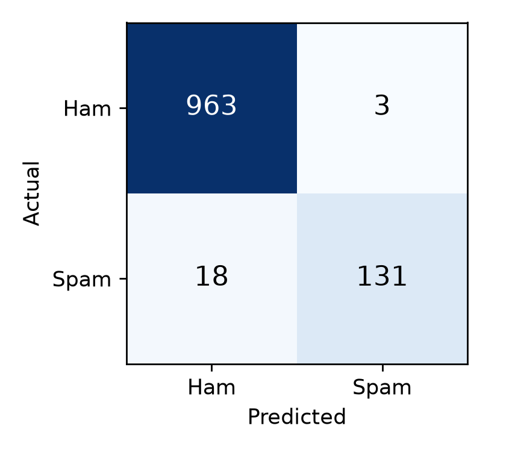
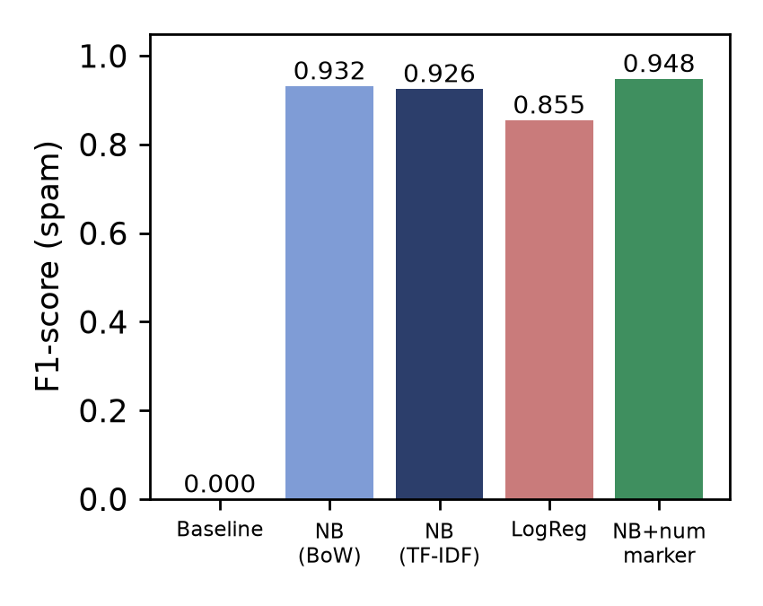

# Spam Message Detection Using Naive Bayes

A small, explainable machine-learning project that classifies SMS messages as **spam** or **ham** (legitimate) using a Multinomial Naive Bayes classifier on TF-IDF features. Built for the *BCSE306L Artificial Intelligence* course at VIT Vellore.

It trains in seconds on a CPU, reports precision and recall (not just accuracy), compares against baselines, and includes a live command-line demo.

## Results

Evaluated on 1,115 held-out messages (149 spam, 966 ham) from the SMS Spam Collection, 80/20 stratified split, seed 42:

| Model | Accuracy | Precision | Recall | F1 |
|---|---|---|---|---|
| Majority baseline (always "ham") | 0.866 | 0.000 | 0.000 | 0.000 |
| Naive Bayes, bag-of-words | 0.982 | 0.945 | 0.919 | 0.932 |
| **Naive Bayes, TF-IDF (main model)** | **0.981** | **0.978** | **0.879** | **0.926** |
| Logistic regression, TF-IDF | 0.966 | 0.991 | 0.752 | 0.855 |
| Naive Bayes, TF-IDF + number marker | 0.987 | 0.972 | 0.926 | 0.948 |

The main model flags only **3 of 966** legitimate messages and misses **18 of 149** spam messages. Accuracy alone is misleading here: about 1 in 7 messages is spam, so always answering "ham" already scores 86.6%.




5-fold cross-validation (mean ± std) is also computed; the two Naive Bayes variants tie on F1 (0.937 ± 0.02). Every number above is written to `results.json` each time the script runs.

## How it works

```
SMS text -> pre-processing -> TF-IDF features -> Multinomial Naive Bayes -> SPAM / HAM
```

1. **Pre-processing:** lowercase, remove non-letters, drop English stop words and single-character tokens.
2. **Feature extraction:** TF-IDF turns each message into a weighted word vector. The vocabulary is fitted on training data only, so nothing leaks from the test set.
3. **Classifier:** Multinomial Naive Bayes with smoothing α = 0.1 (fixed in advance, not tuned).
4. **Evaluation:** accuracy, precision, recall, F1, confusion matrix, 5-fold cross-validation, and comparison with the baselines above.
5. **Live testing:** type any message and get a label with its spam probability.

### Error analysis and extension
Reading the missed spam showed that 10 of the 18 contain a long digit string (phone number or short code). About 78% of spam in the dataset has one, versus 0.06% of ham, but the default cleaning deletes digits. Replacing such strings with a `longnum` marker raised cross-validated F1 from 0.937 to 0.946. This gain is small, within fold-to-fold variation, and the idea came from inspecting errors on the same data, so treat it as suggestive.

## Dataset

[SMS Spam Collection](https://archive.ics.uci.edu/dataset/228/sms+spam+collection) (Almeida, Gómez Hidalgo & Yamakami, 2011). The copy in `data/sms.tsv` has 5,572 messages (747 spam, 4,825 ham), one per line as `label<TAB>message`.

## Project structure

```
.
├── spam_classifier.py   # whole pipeline: train, evaluate, predict
├── data/sms.tsv         # dataset
├── results.json         # all reported metrics (regenerated on each run)
├── fig_confusion.png    # confusion matrix
├── fig_compare.png      # model comparison (F1)
├── requirements.txt
└── README.md
```

`spam_model.joblib` (the trained model) is created when you run the script and is not tracked in git.

## Setup

```bash
git clone https://github.com/<your-username>/spam-message-detection-naive-bayes.git
cd spam-message-detection-naive-bayes
python3 -m venv .venv
source .venv/bin/activate        # Windows: .venv\Scripts\activate
pip install -r requirements.txt
```

## Usage

Train, evaluate and save the model (also writes `results.json` and the figures):

```bash
python3 spam_classifier.py
```

Then classify your own messages interactively (run the command above first so the saved model exists):

```bash
python3 spam_classifier.py --predict
```

Example session:

```
> Hey, are we still meeting for lunch tomorrow?
  -> HAM  (spam probability 0.000)
> WINNER!! You have been selected to receive a £900 prize reward. Call 09061701461 now to claim
  -> SPAM  (spam probability 1.000)
> You have won a $1000 Walmart gift card. Click here to claim
  -> SPAM  (spam probability 0.823)
```

Press Enter on an empty line to quit.

## Limitations

- Trained on one English-language corpus released in 2011, so newer scam styles and other languages are not covered (modern-style spam is caught with lower confidence).
- Naive Bayes ignores word order and context, and assumes words are independent given the class.
- Normal messages that contain spam-like words can be flagged (for example "Call me when you are free").
- No hyper-parameter tuning; the comparison with other models is not exhaustive.

## Future work

Features for URLs and currency symbols, character n-grams, threshold or class-weight tuning to reduce missed spam, comparison with SVMs and transformer models, evaluation on a more recent corpus, and online updating so the filter can follow changes in spam.

## Authors

Himanshu Yadav and Samarth Sahu, School of Computer Science and Engineering, VIT Vellore.

## Reference

Almeida, T. A., Gómez Hidalgo, J. M., and Yamakami, A. 2011. Contributions to the study of SMS spam filtering: new collection and results. *Proceedings of the 11th ACM Symposium on Document Engineering (DocEng '11)*, 259–262.